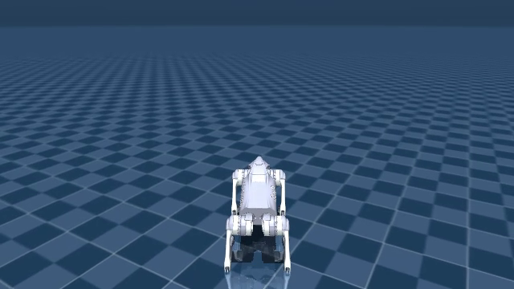

# 手把手：从本地 Go2 模型到四足速度指令跟踪

这份教程的目标是让你最终能独立完成一件事：**给仿真里的 Go2 输入前进、后退、左转、右转指令，训练它尝试跟踪这些目标，检查效果，再修改自己的程序。**

你不需要先读完 PPO 的数学推导。先把一个完整实验做明白，再逐渐理解算法。教程会在操作附近解释当前需要的概念，每一步都说明要确认什么、怎样判断完成，以及下一步为什么接着做。

主角使用你本机 `~/mujoco_models/` 中的 Go2 模型；其他机器可按 [复现说明](../examples/unitree_velocity/README.md) 准备同类资产。配套程序在仓库的 `examples/unitree_velocity/`，打开文件后即可运行和修改。这是我们新建的本地教学任务，复用了 Playground 的现有能力；它有自己的训练入口和实验目录，没有要求你先修改官方任务注册表。

**如果你已经按旧版跑通第 5 步，不需要退回第 1 步重新安装或全部重跑。** 可以先阅读第 5 步的新解释，再准备第 6 步。新的进度显示代码要在下次启动训练进程时才生效，已经运行中的 Python 进程不会自动换成新代码。

第一次阅读，可以按这张路线图定位自己：

| 读到哪里 | 你正在回答的问题 | 这一阶段结束时，应当具备什么 |
| --- | --- | --- |
| 第 0～2 步 | 我想学会什么？要运行哪份程序？ | 能分清目标速度、关节动作、机器人模型与策略 |
| 第 3～4 步 | 我的模型能加载、能仿真、能看见吗？ | 能看见本地 Go2 的默认关节目标仿真 |
| 第 5 步 | 训练、保存、再次加载这条链能走通吗？ | 一份短训练产物；不要求狗已经会走 |
| 第 6 步 | 给它更多经验后，行为有没有改善？ | 一场较长训练及可读的进度和奖励记录 |
| 第 7～9 步 | 四个方向分别做得怎样？还要继续学吗？ | 固定指令的测试视频、速度误差和后续训练方案 |
| 第 10～12 步 | 我怎样亲手设置指令、修改任务或换 Go1？ | 能解释自己改动的目的，并创建新实验验证 |

其中，第 5、6 步都使用同一个 PPO 训练过程。第 5 步把训练量缩得很小，方便先发现程序连接问题；第 6 步才给策略更长的尝试时间和更多经验，开始研究学习效果。它们的具体区别会在第 5 步展开，不需要现在记住所有训练参数。

遇到“这项配置属于哪一层”“这个文件负责什么”时，再打开 [环境与配置结构说明](环境与配置结构说明.md) 查阅。下面先围绕这个实验继续。

## 第 0 步：明确让狗学什么，以及你输入的指令是什么

### 先把目标与动作分开

我们希望机械狗完成的是**速度跟踪**：你提出“向前大约 0.5 米/秒”这样的目标，狗根据身体状态调整关节，尽量让实际速度接近它。

你不会直接为每条腿编写“抬起、迈出、放下”的动作序列。我们要训练一个叫作**策略**的神经网络，让它决定此刻各个关节应该怎样动。

它们的关系可以画成：

```text
你设定：我希望它怎样运动？
        目标速度 [vx, vy, wz]
                    │
                    ├─ 加上当前身体、关节状态等观测
                    ▼
              策略网络计算
                    ▼
              12 维关节动作
                    ▼
      控制器驱动 Go2 模型，推进物理仿真
                    ▼
          得到实际速度、姿态等新状态
                    ▼
     环境计算奖励，供 PPO 改进策略网络
```

这里有四样东西，后面的操作会反复用到：

| 名称 | 本实验中的作用 | 直观判断方法 |
| --- | --- | --- |
| 机器人模型 | 描述 Go2 的身体、关节、电机、质量和碰撞几何 | “它有什么样的身体？” |
| 任务环境 | 给出观测、解释动作、计算奖励、判断结束 | “怎样控制它，怎样算做得好？” |
| 学习算法 PPO | 根据尝试产生的数据更新网络参数 | “怎样从经验里改进？” |
| 策略 | 把当前观测变成关节动作 | “它这一刻决定怎样动？” |

所以，下载 Go2 模型只是准备好了身体。让模型在画面里出现，也不表示里面已经有会走路的策略。后面保存的检查点主要是网络参数等学习数据，与 XML 模型文件各有用途。

### 把“前进”写成三个数

本例用三个量描述速度目标：

```text
command = [vx, vy, wz]
```

| 分量 | 含义 | 单位与正方向 |
| --- | --- | --- |
| `vx` | 前后方向的目标线速度 | 米/秒；正数前进，负数后退 |
| `vy` | 左右方向的目标线速度 | 米/秒；正数向左平移，负数向右平移 |
| `wz` | 目标转身速度 | 弧度/秒；正数左转，负数右转 |

这些目标使用**机身坐标系**。假设地面上画着固定的东、南、西、北，这属于世界坐标系；机身坐标系则跟着狗的朝向转动。狗朝北时，`vx>0` 是向北；它转身朝东后，`vx>0` 就是向东。

第一版先学下面五种指令：

| 程序中的名称 | 默认目标 `[vx, vy, wz]` | 你希望看到的行为 |
| --- | --- | --- |
| `stop` | `[0, 0, 0]` | 尽量原地保持稳定 |
| `forward` | `[0.5, 0, 0]` | 朝机身前方走，目标 0.5 米/秒 |
| `backward` | `[-0.5, 0, 0]` | 朝机身后方退，目标 0.5 米/秒 |
| `left` | `[0, 0, 0.6]` | 尽量原地左转，目标约 34 度/秒 |
| `right` | `[0, 0, -0.6]` | 尽量原地右转，目标约 34 度/秒 |

`left` 是**左转**，不是向左横着走。左转改变朝向，对应 `wz>0`；左移改变位置，对应 `vy>0`。第一版将 `vy` 固定为 0，也先不训练“边前进边转身”的组合，便于逐项理解和检查。

指令中的数字是**目标值**。例如传入 `[0.5, 0, 0]` 不会强制把物理速度改成 0.5；策略仍然要通过关节动作去实现它。训练不足时，狗可能不动、摇晃或摔倒，这正是后面需要检查的学习结果。

训练阶段，程序会随机选择这五类指令，并将非零幅度乘以 0.5～1 的随机比例。例如前进速度约在 0.25～0.5 米/秒之间，左转角速度约在 0.3～0.6 弧度/秒之间。指令也会随时间重新采样。这样训练的是**一个能接收不同目标的策略**，无需为四个方向各建一个网络。

评估阶段则可以将某条指令固定下来，例如持续测试 `forward`。这才容易看出它究竟学会了哪个方向。

**这一段读懂的标志：** 你能解释为什么 `[0.5, 0, 0]` 是给策略的任务目标，而它最后输出的却是 12 个关节控制数。接下来先准备运行这套程序的终端。

> 本文用 `~/mujoco_playground` 表示项目根目录。如果从共享仓库克隆，实际路径通常为 `~/github-shared/mujoco-playground-go2-learning`，将下文两处 `cd` 路径替换为实际位置即可。

## 第 1 步：进入项目目录，确认使用项目的 Python

### 为什么先检查终端环境？

电脑上可能同时装着系统 Python、其他项目的 Python，以及本项目 `.venv` 中的 Python。它们各自能找到的依赖包可能不同。后面即使代码相同，用错解释器也可能报“找不到包”或检测不到 GPU。

打开一个新终端，输入：

```bash
cd ~/mujoco_playground
source .venv/bin/activate
```

- `cd` 是切换当前目录。这里进入的是**仓库根目录**，里面能看到 `pyproject.toml`、`learning`、`mujoco_playground`、`examples` 等文件或文件夹。
- `source .venv/bin/activate` 是在当前终端启用项目虚拟环境，让随后输入的 `python` 优先指向项目解释器。
- 虚拟环境启用状态属于当前终端。另开终端看曲线或运行别的程序时，还需要执行这两行。

代码块里给出的命令可以直接复制。终端可能显示 `sean@电脑名:路径$` 或 `(.venv)` 等提示文字，它们不是要输入的命令，不要一起复制。

确认目录和解释器：

```bash
pwd
which python
```

预期分别看到：

```text
~/mujoco_playground
~/mujoco_playground/.venv/bin/python
```

然后检查 JAX 看到的计算设备：

```bash
python -c "import jax; print(jax.default_backend()); print(jax.devices())"
```

`python -c` 表示直接执行引号里的一小段 Python。这里依次打印默认计算后端和设备列表，训练前应看到类似：

```text
gpu
[CudaDevice(id=0)]
```

本机已验证能够使用 RTX 4060 系列笔记本 GPU，显存约 8GB。若当前输出 `cpu`，先运行：

```bash
nvidia-smi
```

它用于查看 NVIDIA 驱动是否能访问显卡。如果它也失败，优先排查驱动或当前容器、沙箱的 GPU 权限；如果它正常而 JAX 失败，再核对解释器和具体 CUDA 错误。受限运行环境看不到 GPU，不必直接认定之前的安装损坏。

现有安装可以使用，这一步无需重新执行安装、同步依赖或升级 CUDA。先保留一套可以工作的环境，更容易把后续问题定位到代码或参数。

**完成标准：** 当前目录、Python 路径都正确，而且准备运行 PPO 时 JAX 能看到 GPU。接下来认识这次独立实验的文件和入口。后文默认你仍在这个目录，并且虚拟环境已经启用。

## 第 2 步：找到实验文件，学会选择程序要做的事

### 你现在操作的是哪一份项目？

这次在已有仓库里增加了一个独立例程：

```text
~/mujoco_playground/
├── examples/
│   └── unitree_velocity/
│       ├── __init__.py          导出 make_env 等接口，供自己的程序导入
│       ├── environment.py       模型适配、任务配置、训练指令与外部指令设置
│       ├── run.py               模型检查、仿真、训练、评估、键盘查看
│       ├── training_metrics.py  保留结束回合的奖励、终止与超时记录
│       └── test_*.py            指令、重置、进度等自动检查
└── logs/
    └── tutorial_go2/            之后创建的各场实验输出
```

最初需要认识三个核心文件：`environment.py` 决定这个学习任务，`run.py` 把任务连接到训练和评估，`__init__.py` 让你之后能在自己的 Python 文件中方便地导入它们。`training_metrics.py` 配合重置行为保留日志需要的回合信息，`test_*.py` 是辅助自动检查，现在无需先逐行阅读。

它与已有 Playground 的分工是：

- Go2 的身体数据来自你下载的 `mujoco_models`。
- 观测、奖励等很多任务逻辑复用已有 Go1 速度跟踪实现，在教学例程中做 Go2 适配。
- 已安装的 Brax PPO 负责更新策略，JAX 负责相关计算和编译。
- 输出到 `logs/tutorial_go2/…` 的是实验产物，不要把新策略文件写回原始模型目录。

### 使用同一个入口，选择不同功能

在仓库根目录输入：

```bash
python -m examples.unitree_velocity.run --help
```

这条命令的组成是：

```text
python -m  包名.子包名.模块名  要执行的功能  功能参数
```

`-m` 表示按 Python 模块路径运行代码。这里的点号路径对应 `examples/unitree_velocity/run.py`，因此应该从仓库根目录执行；不要先进入 `examples/unitree_velocity` 再照抄同一条命令。

帮助中会列出：

| 功能名 | 它做什么 | 是否学习更新参数 |
| --- | --- | --- |
| `inspect` | 加载模型，打印维度、控制周期和指令定义 | 否 |
| `stand` | 让关节保持默认目标，推进仿真并录视频 | 否 |
| `train` | 采样经验、更新策略、保存检查点 | 是 |
| `evaluate` | 加载检查点，用固定指令测试并记录效果 | 否 |
| `play` | 加载检查点，在桌面窗口用键盘切换指令 | 否 |

因此，“程序跑起来”不一定是在训练。要看你选的是哪种功能：`stand` 没有学习过程，`evaluate` 也不会边测试边偷偷学会新动作。

想查某个功能的参数，将 `--help` 放在它后面。例如：

```bash
python -m examples.unitree_velocity.run inspect --help
python -m examples.unitree_velocity.run train --help
```

现在只需确认帮助能正常显示，不必把全部训练选项背下来。后面每次用到参数时，会说明它在该步骤的作用。

**完成标准：** 你能打开配套代码，运行入口帮助，并能区分检查、仿真、训练和评估。下一步先用 `inspect` 确认它加载的是你的 Go2。

## 第 3 步：检查本地 Go2 模型和任务接口

### 先定位模型文件

你已经下载的文件位于：

```text
~/mujoco_models/mujoco_menagerie/unitree_go2/
├── go2.xml          普通版机器人描述
├── go2_mjx.xml      本例使用的 MJX 版机器人描述
├── scene.xml       普通版场景
├── scene_mjx.xml    本例使用的 MJX 版场景
└── assets/          外形网格等资产
```

MJCF XML 是 MuJoCo 读取的模型描述格式，可以用文本编辑器打开。机器人 XML 主要描述身体和关节；场景 XML 在机器人之外还定义地面、光照等；网格文件让你看到具体外形。要完整加载场景，这些文件之间的引用必须找得到。

这份模型来自 [MuJoCo Menagerie 的 Go2 目录](https://github.com/google-deepmind/mujoco_menagerie/tree/main/unitree_go2)，其中提供了 MJX 专用版本。我们直接复用你本地已经存在的文件。

### 执行模型检查

在前面准备好的终端运行：

```bash
python -m examples.unitree_velocity.run inspect --robot go2
```

这里 `inspect` 表示检查；`--robot go2` 明确选择 Go2。默认路径通过项目现有的 Menagerie 软链接找到你的模型。软链接可以理解为一个指向真实目录的入口，这里最终读到的仍是 `mujoco_models` 中的文件。

输出包含设备信息、模型路径和执行器顺序，关键几行类似：

```text
Robot: go2
nq / nv / nu: 19 18 12
Observation: {'privileged_state': (123,), 'state': (48,)}
ctrl_dt / sim_dt: 0.02 0.004
forward [0.5 0.  0. ]
backward [-0.5  0.   0. ]
left [0.  0.  0.6]
right [ 0.   0.  -0.6]
```

空格和打印顺序可能不同，先理解它告诉你的信息：

| 输出 | 当前怎样理解即可 |
| --- | --- |
| `Robot: go2` 和 XML 路径 | 确认选择了哪只狗、原始模型来自哪里 |
| `nu=12` | 有 12 个执行器，对应策略的 12 维动作 |
| `state: (48,)` | 策略每次读取包含 48 个数的普通观测 |
| `privileged_state: (123,)` | PPO 的价值网络训练时使用 123 个数，含额外仿真信息 |
| `ctrl_dt=0.02` | 每 0.02 秒模拟时间给一次新控制动作，即每模拟秒 50 次 |
| `sim_dt=0.004` | 每个物理小步推进 0.004 秒；一个控制步中有 5 个物理小步 |
| 指令名称及数组 | 核对前后和转向的正负号是否符合第 0 步定义 |

`nq=19`、`nv=18` 是 MuJoCo 的广义位置、速度坐标数量。它们还包含机身的自由运动，不能直接当成腿部关节数。机身姿态使用四元数等描述，所以两种坐标数量也不必相等；现阶段知道它们是模型状态维度即可。

Actor 是负责输出动作的策略网络；Critic 是训练时帮助估计未来表现的价值网络。当前先知道二者看的信息量不同，不必在这里推导它们的优化方法。

### 如需明确指定自己的模型目录

可以运行同一个检查，并写出模型来源：

```bash
python -m examples.unitree_velocity.run inspect \
  --robot go2 \
  --model-dir ~/mujoco_models/mujoco_menagerie/unitree_go2
```

`--model-dir` 指向含有 `go2_mjx.xml`、`scene_mjx.xml` 和 `assets` 的 **Go2 子目录**，不要写成 `~/mujoco_models`。以后将模型移到别处时，也应指向保持了这些配套文件的目录。

上述多行命令末尾的 `\` 是 Bash 的续行符，表示“这一行尚未结束，接着读下一行”。最后一行没有 `\`。复制时保留这些符号；不要在 `\` 后再加注释或其他文字。

### 为什么不能只把 Go1 的文件路径换成 Go2？

已有 Go1 任务代码会按名称读取机身、足端和传感器，也会假设某种动作含义。Go2 的身体与传感器命名、关节顺序、质量惯量等并不完全相同，所以本地例程增加了一层适配：

1. 在内存中组合场景和机器人 XML，补上复用任务需要的传感器。
2. 将 `base`、足端 site 等名称映射到已有代码能够识别的名称；site 可理解为模型中用于测量或定位的标记点。
3. 将动作解释为关节目标位置，设置 `Kp=35`、`Kd=0.5` 的控制参数，并清除重复的执行器速度阻尼项。
4. 保留脚部与平地的接触，关闭机身、腿部与自身之间的碰撞，降低这个入门任务的计算开销。
5. 将训练指令收窄到前后、左右转和停止，便于逐项观察。

这些适配由程序加载时完成，原始模型文件保持原样。第 3 项的控制参数和第 4 项的接触简化属于这个教学任务的设置，不能自动视为真实 Go2 的标定结果。

**这个检查通过，说明文件与接口可以连接起来；还不能证明仿真参数与真实机器人完全一致。** 例如“只让脚与地面碰撞”就已经是一项明确简化。以后研究障碍物、摔倒接触或真机迁移时，需要重新检查这部分模型设计。

同理，Go1 与 Go2 即使都输出 12 个动作，也不能直接把 Go1 的旧参数当成 Go2 已学会走路的策略。当前例程给 Go2 单独开展训练。

**完成标准：** 路径和机器人选择正确，维度与指令表符合预期，命令没有报模型或资产缺失错误。下一步不再只看数字，而是推进一小段仿真并看实际画面。

## 第 4 步：运行默认关节目标仿真，确认身体能动、画面能生成

### 这一段还没有训练

先让每个关节尝试保持模型给定的站立目标，观察物理仿真和渲染是否接通。运行：

```bash
python -m examples.unitree_velocity.run stand \
  --robot go2 \
  --steps 100 \
  --output logs/tutorial_go2/stand.mp4
```

这一条命令中，每个参数的用途如下：

| 参数 | 本次含义 | 以后怎样改 |
| --- | --- | --- |
| `stand` | 使用默认关节目标推进仿真，不更新策略 | 先保持这一功能，理解它与 `train` 的区别 |
| `--robot go2` | 创建本地 Go2 教学任务 | 想比较 Go1 时可以明确选择 `go1` |
| `--steps 100` | 最多执行 100 个控制步 | 改大表示模拟更长时间，不是录制文件的帧数 |
| `--output …/stand.mp4` | 输出视频的路径 | 可换文件名保留不同试验；同一路径可能被覆盖 |

输出目录会由程序创建，无需提前手动建好每一级文件夹。`--steps` 是参数名，`100` 是传给它的值，两者之间留一个空格。

### 理解“模拟 2 秒”和“等待 2 秒”的区别

当前 `ctrl_dt=0.02`，所以 100 个控制步对应：

```text
100 × 0.02 秒 = 最多 2 秒模拟时间
```

这是仿真世界里走过的时间。电脑实际执行还要计算、编译和渲染，尤其首次运行时可能等待远不止 2 秒。如果先发生了任务终止，程序会提前结束，视频也可能更短。

JAX 的 `jit` 会先将反复使用的计算编译，再执行它。第一次出现等待并不等于程序没有做事，也不需要马上结束后反复重启。命令结束时，终端应打印视频的完整保存路径。

打开文件管理器，找到并播放：

```text
~/mujoco_playground/logs/tutorial_go2/stand.mp4
```

下面是本机实际导出视频的一帧，可用于核对 Go2 和平地是否成功显示。初始位置和朝向含随机性，不要求画面与你的结果完全一致。



### 为什么“零动作”仍然能让电机用力？

此功能给环境的是 12 维零动作，但任务把它解释为默认姿态附近的关节目标：

```text
关节目标 = 默认站立关节角 + action_scale × 动作
```

动作全为 0 时，右边剩下“默认站立关节角”。位置控制器仍然会根据关节与目标的差距施力，让关节尽量接近目标。**它不是把电机力矩清零，也不是策略已经学会站立。**

这一段没有收集经验来优化神经网络，没有 PPO 参数更新。机身可能晃动、位移或受到初始化扰动，也不能仅凭这段视频就判断学习能力。

如果没有生成视频，应按报错所在阶段检查：

- 找不到 XML、网格等：先回到第 3 步核对模型路径。
- JAX/CUDA 初始化报错：回到第 1 步核对计算设备。
- 明确报 EGL/OpenGL 或 ffmpeg 错误：排查画面生成或视频编码阶段。

这些阶段不同，暂时不必去改奖励或学习率。

**完成标准：** 命令能正常结束，MP4 可以播放，能看见 Go2 与地面，仿真没有明显的数值错误。到这里，你已确认“模型加载 → 控制关节 → 推进仿真 → 显示画面”能工作。

下一步才首次使用 `train`：让神经网络参与控制，并根据经验更新参数。我们会先做很短的一场训练，检查这条新增的学习链能否正常运行，再投入更大的训练量。

## 第 5 步：用四轮真实训练检查链路，先确认程序能正确串起来

前面你完成了“模型能创建，仿真能推进，默认关节目标能产生画面”。但还有几件事没检查过：神经网络能否读取观测、PPO 能否计算梯度并更新参数、模型能否保存和再次加载。

第 5 步就是把这些部件接起来，做一次很短的端到端试跑。**这一步确实在训练，也确实修改了策略参数。它与第 6 步使用同一种算法，区别在于目的、训练量和回合长度。**

| 对比 | 第 5 步：训练流程检查 | 第 6 步：学习速度跟踪 |
| --- | --- | --- |
| 这一步回答的问题 | 采样、更新、记录、保存、加载是否都能工作？ | 在更多尝试之后，策略的控制表现是否改善？ |
| 是否运行 PPO、更新参数 | 是 | 是 |
| 采样预算 | 2048 个环境交互样本 | 500 万个环境交互样本起步 |
| 每回合最长时间 | 32 步，即 0.64 秒 | 1000 步，即 20 秒 |
| 是否要求狗会走 | 不要求 | 开始观察，并继续训练和评估 |
| 完成条件 | 程序结束、指标有效、检查点可加载 | 需要结合曲线、方向、速度误差与稳定性判断 |

这一检查**不等于验证物理模型完全准确**。模型质量、摩擦和控制器是否匹配真实 Go2，需要另外校准。训练程序没有报错，也不能证明奖励设计已经合理。

### 5.1 在输入训练命令前，先分清四种“计数”

如果把它们都叫“轮次”，就很难理解程序在做什么。

**一个控制步（step）：一只狗接收一次动作，环境推进 0.02 秒，返回新的观测和奖励。** 它内部还有 5 个更细的物理仿真小步，这不影响我们在训练命令中按控制步记采样量。

**一个回合（episode）：一次从重置开始的尝试。** 狗翻倒或达到最大时长，这次尝试结束，重新初始化后再来。回合可以很短，也可以很长；并行的狗会各自结束，不必一起结束。

**一轮 PPO 采样更新：收集一整批经验，用它更新策略，然后再收集下一批。** 本教程终端中的“采样更新轮次 当前/总数”指这一项。它不是某一只狗的回合编号，也不是一次梯度计算的编号。

**一次评估（evaluation）：暂时用当前策略做测试，记录表现，不在这段测试里更新网络。** 评估可以穿插在训练之间，像隔一段时间做一次测验。

把一次训练展开来看：

```text
新建随机策略
    ↓
初始评估：还没有进行学习，记录起点
    ↓
第 1 轮：收集一批交互经验 → PPO 更新网络
第 2 轮：用更新后的策略再采样 → 再更新
……
    ↓
阶段评估：用当前策略测试表现，并保存检查点
    ↓
继续后面的采样更新轮次
    ↓
最终评估、保存，训练结束
```

因此，最初显示 `steps=0` 并不是“训练卡在第零步”，而是在报告**尚未学习时的初始评估**。旧版脚本只在评估回调时打印，所以第 5 步看起来只有开头和结尾。新版本会额外接收训练中的指标回调，逐轮显示真实进度。

### 5.2 运行这场短训练

保持第 1 步激活的终端，确认仍在仓库根目录，执行：

```bash
python -m examples.unitree_velocity.run train \
  --robot go2 \
  --run-dir logs/tutorial_go2/smoke \
  --num-timesteps 2048 \
  --num-envs 32 \
  --num-eval-envs 4 \
  --batch-size 32 \
  --num-minibatches 2 \
  --unroll-length 8 \
  --num-updates-per-batch 1 \
  --episode-length 32 \
  --num-evals 2 \
  --log-every-updates 1
```

**如果你已经跑过原来的第 5 步且成功，不需要为了学习再跑一次。** 如想亲自查看新日志，换一个新目录，例如 `--run-dir logs/tutorial_go2/smoke_progress`，再执行这条命令；后面的检查点路径也相应替换。旧训练进程不会因为文件更新就自动获得新日志格式，新启动的进程才会使用修改后的代码。

Shell 里的行末 `\` 表示命令还没结束，下一行仍属于同一条命令。复制时从 `python` 开始，一起复制整个代码块；不要在 `\` 后面加空格或注释。下面用表格逐项说明参数，你不需要在命令行中自行插入注释。

### 5.3 这条命令中的每个参数分别做什么？

先看“选择什么、保存哪里”：

| 参数 | 此处的意思 | 为什么这样设 |
| --- | --- | --- |
| `train` | 选择训练功能 | 与前面的 `inspect`、`stand` 是不同功能 |
| `--robot go2` | 创建本例的 Go2 速度跟踪任务 | 使用已经检查过的本地 Go2 模型 |
| `--run-dir …/smoke` | 给本场实验一个独立目录 | 保存参数、设置与日志，方便以后找到和复现 |

再看“尝试多少、同时几只狗、每次最长多久”：

| 参数 | 单位与含义 | 此处设置的理由 |
| --- | --- | --- |
| `--num-timesteps 2048` | 所有训练环境合计的控制步样本数预算 | 只做少量更新，尽快检查链路 |
| `--num-envs 32` | 同时采样的训练环境数量 | 一次模拟 32 只互不干扰的狗，先用小规模 |
| `--episode-length 32` | 每只狗每回合最多 32 个控制步 | 人为把一次尝试缩短到 0.64 秒，不用于学习完整步态 |

`num-envs` 与 `num-timesteps` 不是同一个量：32 只狗各走一步，总共贡献 32 个样本。把并行数改大，是让更多环境同时贡献经验，不是让某一只狗每秒动作更多；它的控制间隔仍是 0.02 秒。

接下来是“怎样把经验交给 PPO”。这些参数确实需要解释，而不是只说“成套使用”：

| 参数 | 含义 | 用这条命令举例 |
| --- | --- | --- |
| `--unroll-length 8` | 一段采样序列包含 8 个连续控制步 | 一条短序列包含“连续观察与行动 8 次”的经验 |
| `--batch-size 32` | 每个优化小批次包含 32 条这样的序列 | 每个小批次有 32×8=256 个交互样本 |
| `--num-minibatches 2` | 每轮的整批经验分成 2 个优化小批次 | 两个小批次合计 64 条序列、512 个样本 |
| `--num-updates-per-batch 1` | 用同一整批经验完整优化 1 遍 | 每遍会依次处理上述 2 个小批次；这不是再采一批新经验 |

这里 `batch-size` 是**轨迹序列的条数**，不要直接当成所有样本总数。每轮真正新增的交互样本数是：

```text
每轮采样量
= batch_size × num_minibatches × unroll_length × action_repeat
= 32 × 2 × 8 × 1
= 512 个样本
```

本例把 `action_repeat` 固定为 1，命令里不需要再传。

由此可以算出本场短训练只有：

```text
2048 ÷ 512 = 4 轮 PPO 采样更新
```

再从单只狗的角度看：32 个并行环境共同收集 512 个样本，平均每只狗走 16 步；每条序列长 8 步，因此每只狗收集两段序列。回合最长 32 步，所以它可能跨过两轮采样更新才结束一个完整回合。**回合边界与 PPO 更新边界不必重合。**

最后是“什么时候测试、什么时候打印”：

| 参数 | 含义 | 此处的作用 |
| --- | --- | --- |
| `--num-eval-envs 4` | 每次评估同时运行 4 个测试环境 | 用少量测试环境确认评估可运行；这些样本不计入训练预算 |
| `--num-evals 2` | 初始评估加 1 次训练后评估 | 在这场只有 4 轮的训练中，先测起点、最后测一次 |
| `--log-every-updates 1` | 每完成 1 轮采样更新，输出一次训练进度 | 中间四轮都能看见，不必等最终评估 |

`num-evals` 控制独立评估的频率，`log-every-updates` 控制训练中报告进度的频率。想更常看进度，调后者；不必为打印日志而频繁做完整评估。

### 5.4 为什么批次参数还要满足整除关系？

程序把整批序列分给并行环境收集，当前 Brax 要求：

```text
(batch_size × num_minibatches) % num_envs == 0
```

在本例中，`32×2=64`，能被 `32` 整除，每个环境恰好贡献两段序列。如果把 `num-envs` 随手改成 100，这个分配就不满足要求。

所以调整并行数时，要同时检查 `batch-size` 和 `num-minibatches`。现在先把这条关系当作一条明确的配置检查规则，后面再用两组实际配置对照。

### 5.5 运行时看什么？怎样读新的进度输出？

启动时会先打印实验目录、每轮采样量、预计更新轮数和实际采样预算。短训练应是每轮 512 样本、共 4 轮。

随后出现三个阶段：

1. **初始化和编译**：创建状态、网络，编译评估或采样更新计算。JAX 第一次执行要先编译，这段时间没有完成更新，不会编造一个逐轮进度条。
2. **初始评估**：轮次 0/4，步数 0，显示 `eval_reward`。
3. **采样更新与最终评估**：训练回调显示轮次 1/4、2/4、3/4、4/4；评估回调单独显示 `eval_reward`。评估、检查点写入和程序收尾也需要时间，因此采样到 100% 后还需等命令正式结束。

日志中的两个 reward 要分别理解：

- **`train_reward`**：采样训练期间，最近已完成回合的累计奖励均值。训练会探索、使用随机动作；没有任何完整回合结束时，显示“暂无已完成回合”。这不是零奖励，也不是程序出错。
- **`eval_reward`**：独立评估中的回合累计奖励均值。本例评估使用确定性策略，主要用它比较同一任务设置下的学习表现。

两者使用的策略随机性、样本和统计窗口不同，不能要求每次打印完全相同，也不要把交错的两种数字当成一条连续奖励曲线。训练回报来自当前轮更新前采集的经验；更新后的策略再做独立评估，表现也可能已经改变。很短的失败回合更早进入训练统计，而仍在继续的长回合暂时不计入，因此早期的这两种均值可能相差很大。

终端 reward 固定显示六位小数，采用**向零截断**：例如 `1.23456789 → 1.234567`，`-1.23456789 → -1.234567`。TensorBoard 和 `metrics.jsonl` 仍保留原始记录精度，显示格式不会改变 PPO 的计算。

例如，下面是短训练的**日志格式示意，奖励和耗时不是固定结果**：

```text
[初始评估] 轮次=0/4 | 进度=  0.00% | steps=0/2,048 | eval_reward=0.031595 | 已用=89.9s
[采样更新] 轮次=1/4 | 进度= 25.00% | steps=512/2,048 | train_reward=暂无已完成回合 | 已用=121.8s
……
[采样更新] 轮次=4/4 | 进度=100.00% | steps=2,048/2,048 | train_reward=0.300123 | 已用=124.6s
[阶段评估] 轮次=4/4 | 进度=100.00% | steps=2,048/2,048 | eval_reward=0.320924 | 已用=126.0s
```

如果只有初始化提示，说明还没有完成可以汇报的更新，先等待编译。如果看见轮次增加，即使 reward 还很小，说明采样更新正在推进。若更新很快、日志太密，可改成 `--log-every-updates 5`，每五轮报告一次；初始和阶段评估仍会单独报告。

### 5.6 怎样判断第 5 步已经完成？

命令正常结束后，检查：

```text
logs/tutorial_go2/smoke/
├── experiment.json              实际环境、PPO、网络、模型来源等设置
├── metrics.jsonl                原始指标和采样步数
├── events.out.tfevents.…        TensorBoard 曲线文件
└── checkpoints/
    └── 000000002048/            本配置最终 2048 步的检查点
```

如果你换过参数，数字目录可能不同；训练按整批经验推进，实际预算可能向上取整。

接下来，检查参数能否重新加载：

```bash
python -m examples.unitree_velocity.run evaluate \
  --checkpoint logs/tutorial_go2/smoke \
  --commands forward \
  --episodes 1 \
  --steps 64 \
  --output logs/tutorial_go2/smoke_check \
  --video
```

这次每个参数的作用是：

| 参数 | 含义 |
| --- | --- |
| `evaluate` | 只测试策略，不进行学习更新 |
| `--checkpoint …/smoke` | 从这个实验中选取最新完整检查点 |
| `--commands forward` | 固定给前进指令，替代训练时随机抽指令 |
| `--episodes 1` | 只测试一次初始化，快速确认加载链路 |
| `--steps 64` | 这次测试最多走 64 步，即 1.28 秒；若翻转则提前结束 |
| `--output …/smoke_check` | 本次评估单独保存到新目录 |
| `--video` | 同时生成画面，便于确认参数确实驱动了模型 |

注意：评估的 `--steps` 是**每次测试**的长度；训练的 `--num-timesteps` 是**所有并行训练环境合计**的预算，二者不是同一种计数。

打开 `smoke_check/forward.mp4`，并查看同目录的 CSV 与 `summary.json`。短策略可能只是晃动、站着不动或走错方向，这仍可能通过工程流程检查。完成标准是：程序正常结束、参数保存完整、能再次加载、测量数值有效并能导出视频。

**如果以上已经通过，就结束第 5 步，不用反复在这场超短实验里追求走路效果。下一步扩大训练预算和回合长度，才开始认真观察学习。**

## 第 6 步：从新策略开始，给它足够的时间尝试速度跟踪

你现在知道训练链路可以工作了，接下来要回答一个不同的问题：**沿用同一套任务与算法，多尝试一些，狗能否逐渐学会跟随指令？**

这一阶段仍是“采样一批 → 更新策略 → 再采样”。我们改变的是实验规模，而不是换一种学习机制。

### 6.1 先看这次相对第 5 步改变了什么

| 项目 | 第 5 步 | 第 6 步 | 为什么改 |
| --- | --- | --- | --- |
| 起始策略 | 随机初始化 | 重新随机初始化 | 不沿用只做过极短检查的参数，建立自己的学习基线 |
| 总采样预算 | 2048 | 5,000,000 | 更多经验和更新机会 |
| 并行环境 | 32 | 1024 | 利用显卡同时收集更多经验 |
| 每回合最长步数 | 32 | 1000 | 给持续站立、迈步和跟踪速度足够的模拟时间 |
| 一段序列长度 | 8 | 20 | 采用更正常的经验序列长度 |
| 同一批经验优化遍数 | 1 | 4 | 更充分地利用采集到的经验 |
| 评估次数 | 2 | 5 | 在起点和中间阶段观察变化 |

**下方命令没有 `--restore`，所以不会自动接着 `smoke` 训练。** 它建立一个新的实验 `first`，从新随机策略开始。已有文件夹里的模型不会被自动选中，也不会因为命令中同样写了 `go2` 就接着上次运行。

本阶段称作“学习实验”，意思是开始观察策略能力的变化，并不意味着运行一次就一定收敛。500 万步是便于先观察的起点；稳定行走可能还需要更多预算，任务奖励和模型适配也会影响结果。

### 6.2 启动这场学习实验

```bash
python -m examples.unitree_velocity.run train \
  --robot go2 \
  --run-dir logs/tutorial_go2/first \
  --num-timesteps 5000000 \
  --num-envs 1024 \
  --num-eval-envs 32 \
  --episode-length 1000 \
  --batch-size 256 \
  --num-minibatches 4 \
  --unroll-length 20 \
  --num-updates-per-batch 4 \
  --num-evals 5 \
  --log-every-updates 1 \
  --seed 1
```

这次给每只狗最长 1000×0.02=20 秒的回合，足以让一段运动展开。20 秒是**模拟时间**，并不是你必须等满 20 秒墙钟时间，也不代表每次都存活 20 秒：翻倒后会提前重置。

`--seed 1` 指定随机种子，控制初始状态、指令与训练随机过程的起点，便于记录和对照；它不保证跨设备、跨版本或改过参数后得到完全相同的轨迹。

其他参数与第 5 步含义相同，只是值改变了。对于这组参数：

```text
每轮采样量 = 256 × 4 × 20 = 20,480
1024 个环境各贡献一段 20 步序列
每个小批次处理其中 256 条序列，共 4 个小批次
同一批经验完整使用 4 遍
```

因此，一轮里会进行 4×4=16 次小批次优化，但**进度中的采样更新轮次仍然只增加 1**。数据重复使用不会把 20,480 个新样本变成 81,920 个新样本。

### 6.3 为什么总轮数和实际步数会取整？

本例保留 5 次评估：1 次初始评估，加训练过程中的 4 次评估。Brax 把更新划分到这 4 个阶段，每阶段必须完成整数轮：

```text
每阶段更新轮数 = 向上取整(5,000,000 ÷ 4 ÷ 20,480) = 62
总采样更新轮数 = 4 × 62 = 248
预计实际采样量 = 248 × 20,480 = 5,079,040
```

所以你会看到轮次最终达到 `248/248`，而实际样本数略超 500 万。这是按整批、整阶段训练的结果，不是程序多跑了不明原因的循环。不要拿“每只狗的回合次数”去解释这个 248。

增大并行数通常能提高吞吐量，但同一总采样预算下，如果整批采样量也变大，更新轮数会减少。例如让每轮收集原来两倍的数据，同预算下大约只有一半轮数。因此“更大批次”既影响资源，也影响学习节奏，不能只以显存是否用满来判断好坏。

### 6.4 训练究竟在努力改善什么？

策略每次看到 48 个数：

```text
机身线速度 3 + 角速度 3 + 重力方向 3
+ 相对默认姿态的关节角 12 + 关节速度 12
+ 上一步动作 12 + 当前速度指令 3 = 48
```

你在第 0 步定义的前进、后退、左转、右转指令，就放在这份观测最后三个位置。策略并不知道中文“前进”的意思；它要通过反馈学会：怎样安排关节动作，才能让自己的速度接近这三个目标值。

奖励不只包括速度跟踪，还包括姿态、动作平滑、关节限制、能耗和脚滑动等。为什么需要这些项？因为单纯追求速度可能产生跳动、猛甩、翻滚等不希望的行为。它们共同约束“怎样跟上指令”。

它训练的是一个**接收不同指令的统一策略**。同一个网络在不同时间看到不同速度目标，然后作出不同的关节控制；不是按方向训练四个互不相干的网络。

训练中回合结束后，程序会一起重置物理状态、指令和动作历史。记录给日志的终止回合指标会保留，以便正确报告训练奖励与超时；下一回合开始后重新累计。

### 6.5 打开曲线，配合终端观察

另开一个终端，重新进入目录并激活虚拟环境：

```bash
cd ~/mujoco_playground
source .venv/bin/activate
tensorboard --logdir logs/tutorial_go2 --host 127.0.0.1 --port 6006
```

浏览器访问 [TensorBoard](http://localhost:6006)。服务会一直运行，等着你打开页面；这不妨碍另一个终端的训练。

| 参数 | 作用 |
| --- | --- |
| `--logdir logs/tutorial_go2` | 读取这个目录及子目录的 event 文件，不会启动新训练 |
| `--host 127.0.0.1` | 在本机提供页面 |
| `--port 6006` | 本机浏览器访问使用的端口；被占用时可换成 6007，网址也一起改 |

本教学入口默认记录 TensorBoard，不需要再传官方脚本的 `--use_tb`。页面里的不同实验目录应分开选择：先看 `first`，不要把第 5 步的 32 步短回合混进同一比较。

先按以下顺序观察，暂时不必研究所有 loss：

| 指标 | 你要回答的问题 |
| --- | --- |
| `eval/episode_reward` | 同一任务、同一回合设置下，独立评估总体有没有改善？ |
| `episode/sum_reward` | 训练中最近完成的回合拿到了多少累计回报？ |
| `eval/avg_episode_length` | 每次评估能持续多久，是否总是很快翻倒？ |
| `eval/episode_reward/tracking_lin_vel` | 线速度跟踪分量有没有改善？ |
| `eval/episode_reward/tracking_ang_vel` | 转向跟踪分量有没有改善？ |

各奖励分量带有自己的计算和尺度，不能只比较“哪个分量数字最大”。策略损失和价值损失也不是普通作业分数，并非越小就一定走得越好。

初期可能看见 `train_reward=暂无已完成回合`：如果狗还没结束一次尝试，回报还不能作为完整回合统计；它会继续采样。不要为了立刻看到数字就把回合长度改回 32，那会改变你正在训练的任务。

### 6.6 训练中哪些现象值得记录？

你可以为 `first` 写一份很短的实验笔记：

1. 初始评估的回报和平均回合长度是多少？这是未学习时的起点。
2. 随着轮次推进，独立评估回报是上升、波动还是长期停滞？
3. 是否更少翻转、能否持续更久？
4. 阶段检查点出现后，分别给四个方向，实际运动是否符合要求？

第 4 个问题需要下一步的视频和速度记录才能回答。因此不要只看总奖励宣布成功，也不要看到一次下降就认定失败。

**第 6 步的完成动作是：保存一个可评估的检查点，记下其训练设置，然后进入第 7 步检查能力。** 如果训练尚未结束、已经产生阶段检查点，也可以用另一个终端评估；同一 GPU 上同时训练与渲染会竞争资源，初学时先等训练结束，流程更清楚。

### 6.7 显存还有很多空余，怎样逐步扩大？

第 5 步只有 32 个训练环境，显存较低本来就是预期行为，它不是显卡能力测试。第 6 步已将学习配置提高到 **1024 个训练环境、32 个评估环境**，并同步调整了批次；它比旧教程的 256 个训练环境更大。

想进一步调整，先看这张成套配置表，表外参数暂时保持第 6 步不变：

| 使用场景 | `num-envs` | `batch-size` | `num-minibatches` | `num-eval-envs` | 每轮样本数（unroll=20） |
| --- | ---: | ---: | ---: | ---: | ---: |
| 较小资源配置 | 256 | 128 | 4 | 16 | 10,240 |
| 本文学习起点 | 1024 | 256 | 4 | 32 | 20,480 |
| 下一档尝试 | 2048 | 512 | 4 | 32 | 40,960 |
| 确认上一档稳定后再试 | 4096 | 1024 | 4 | 32 | 81,920 |

例如，尝试下一档时，只替换对应的四个值，并使用新的实验目录 `first_2048`。先确认它能稳定跑，再比较每秒样本数与同预算下的评估效果。2048、4096 档是后续扩容尝试，尚未按本文完整设置实测；不能因为 1024 可运行就假定它们在任意显存占用下都安全。

另一个终端可运行：

```bash
nvidia-smi -l 1
```

`-l 1` 表示每隔 1 秒刷新。看显存占用、GPU 利用率和其他进程，不必追求显存占满。评估批次、编译临时缓冲也可能需要额外空间。按 `Ctrl+C` 只会停止这个监控命令，不会停止另一个终端的训练。

增大并行数不会提高每只狗的控制频率；也不等于增加总训练样本。`--num-timesteps` 不变时，预算大致仍是那些样本，只是收集与分批方式变化了。更快采样和更容易学会是两件需要分别测量的事。

### 6.8 如果要中途停止

在**训练所在终端**按 `Ctrl+C`。已经完整保存的检查点可用于后续加载，尚未保存的数据可能丢失。新的日志配置不会让尚未到阶段保存点的轮次自动拥有检查点。

如果你的目的只是减少打印频率，改用 `--log-every-updates 5` 或 `10` 重新启动实验，不需要为此改变评估次数。每轮日志有少量设备到主机同步开销，正式长实验可以适当降低频率。

首次编译没有逐轮输出是正常的；如果长时间没有任何新结果，要结合终端错误、GPU 进程和显存看原因。程序能跑但策略不进步，则回到奖励、观测、控制、训练预算和第 7 步的评估，不要先重装整个环境。

## 第 7 步：固定输入指令，检查“学到的能力”，而不只是“训练跑完了”

第 6 步的总回报混合了不同指令和奖励项，不能告诉你每一种行为是否都会。所以我们现在做一份分别测试的能力报告。

### 7.1 用同一个检查点逐项测试

```bash
python -m examples.unitree_velocity.run evaluate \
  --checkpoint logs/tutorial_go2/first \
  --commands stop forward backward left right \
  --steps 250 \
  --episodes 3 \
  --speed 0.5 \
  --yaw-rate 0.6 \
  --output logs/tutorial_go2/first_eval \
  --video
```

与第 5 步的加载检查使用同一个评估程序，但现在测试项目更多、时间更长、每项重复多次：

| 参数 | 此处的作用 | 为什么这样设 |
| --- | --- | --- |
| `--checkpoint …/first` | 读取第 6 步实验的最新完整检查点 | 不再使用只做过 4 轮的 `smoke` |
| `--commands …` | 分别测试停止、前进、后退、左转、右转 | 防止只学会某一种动作却被总回报掩盖 |
| `--steps 250` | 每次测试最多 250 步，即 5 秒 | 看一小段持续行为，而不是一两帧 |
| `--episodes 3` | 每种指令用 3 次不同初始化 | 降低偶然一次成功的误导 |
| `--speed 0.5` | 前后目标速度的绝对值 0.5 m/s | 前进用正值，后退由程序自动取负值 |
| `--yaw-rate 0.6` | 左右目标角速度的绝对值 0.6 rad/s | 左转用正值，右转自动取负值 |
| `--output …/first_eval` | 新建本次能力评估的输出目录 | 把训练和评估产物分开 |
| `--video` | 每种指令保存第 1 次测试的画面 | CSV 包含全部重复测试，视频只展示其中一次 |

速度和角速度参数传非负幅值即可，不要为了后退给 `--speed` 传负数。

### 7.2 先看视频，再看数值

输出目录例如：

```text
logs/tutorial_go2/first_eval/
├── stop.mp4        stop.csv
├── forward.mp4     forward.csv
├── backward.mp4    backward.csv
├── left.mp4        left.csv
├── right.mp4       right.csv
└── summary.json
```

建议先看 `stop.mp4`：能否保持合理站立，而不是趴着不翻？接着比较前进与后退的方向，再比较左右转身。方向以狗的朝向为准，不以视频屏幕左、右为准。

然后打开 CSV，它包含：

| 字段 | 含义 |
| --- | --- |
| `episode`、`time` | 哪次测试、从开始经过多少模拟秒 |
| `target_vx/target_vy/target_wz` | 传给策略的目标速度 |
| `vx/vy/wz` | 环境测到的实际机身速度与角速度 |
| `done` | 本步是否触发任务终止 |

例如前进目标是 `target_vx=0.5`，实际 `vx` 若长期在 0.05 附近，就算没翻倒也没有可靠跟上目标。后退时则要看实际 `vx` 是否以负值为主；左右转向分别看 `wz` 的正、负与大小。

### 7.3 `summary.json` 能说明什么，不能说明什么？

- `episodes`：这一项测了多少次。
- `completed`：其中多少次达到指定时长，且没有触发本任务的终止规则。
- `mean_abs_error_vx_vy_wz`：排除最初 1 秒启动过渡后，三个速度分量各自的平均绝对误差。

三个误差的单位分别是 m/s、m/s、rad/s，要分开看，不宜直接相加作为万能总分。如果没有存活超过 1 秒的有效数据，误差显示 `null`，不是零误差。

**当前终止规则沿用原任务：机身朝上轴的竖直分量小于 0 时，视为翻转。** 当前没有额外的趴地或低机身高度终止规则，Go2 接触模型又经过简化，所以 `completed=3` 不等于三次都稳定走好了。机身穿地、拖行等异常还要靠视频识别，后续可为这些情况增加明确的失败条件。

若中途触发翻转，程序会结束这次测试，不会自动重置后把多个片段拼成一次连续成功。平均误差只描述有效存活段，应与完成次数和视频共同判断。

### 7.4 做完评估，怎样决定下一步？

| 观察结果 | 下一步 |
| --- | --- |
| 程序、视频正常，但几乎不走或方向错误 | 先确认还在用极短 `smoke` 还是学习实验；预算不足时按第 9 步继续训练 |
| 部分指令已能跟踪，其他指令很差 | 保留报告，检查训练是否覆盖这些指令、各项奖励是否平衡，再做单因素实验 |
| 经常翻转，或通过趴地获得表面好成绩 | 检查姿态、接触、终止和奖励，不只增加并行数 |
| 方向基本正确、能重复并接近目标 | 可用第 8 步体验指令切换，再用第 10、11 步学习修改 |

若只想检查更慢的前后速度，可用新评估目录：

```bash
python -m examples.unitree_velocity.run evaluate \
  --checkpoint logs/tutorial_go2/first \
  --commands forward backward \
  --speed 0.3 \
  --steps 250 \
  --episodes 3 \
  --output logs/tutorial_go2/slow_eval \
  --video
```

这只是改变测试时输入的目标，不会更新策略。输入远超训练分布的速度不保证有效；扩大能力范围，需要把新目标加入训练分布再学习。

## 第 8 步：在本机用键盘切换速度指令（可选）

固定指令测试回答“单项能否做到”；键盘体验则让你看到策略收到新指令之后怎样响应。此项需要本机桌面图形会话，先完成视频评估再尝试：

```bash
MUJOCO_GL=glfw python -m examples.unitree_velocity.run play \
  --checkpoint logs/tutorial_go2/first \
  --viewer
```

| 写法 | 含义 |
| --- | --- |
| `MUJOCO_GL=glfw` | 为这一次命令选择桌面窗口的图形后端，不是重新安装 MuJoCo |
| `play` | 加载策略并交互查看，不进行训练 |
| `--checkpoint …` | 仍使用第 6 步的策略 |
| `--viewer` | 明确启动本机 MuJoCo 查看器窗口 |

点击查看器使它获得键盘焦点：W 前进，S 后退，A 左转，D 右转，空格停止。它采用“按一次就保持，直到下次按键”的方式；松开 W 不会自动停止，想停下按空格。

若策略还没有学会相应行为，按键也不能让它立刻做到。这里改变的是输入的速度目标，控制关节的仍是训练得到的策略。

本次自动验证覆盖视频与数值流程，键盘窗口需要你在本机桌面中体验；SSH 或无显示器环境先使用第 7 步，不必为了完成教程强行配置 GUI。

## 第 9 步：保留已有能力，加载参数继续学习

第一次训练预算用完，但评估显示还没学好，可以显式加载旧参数再尝试更多数据：

```bash
python -m examples.unitree_velocity.run train \
  --robot go2 \
  --restore logs/tutorial_go2/first \
  --run-dir logs/tutorial_go2/continued \
  --num-timesteps 20000000 \
  --num-envs 1024 \
  --num-eval-envs 32 \
  --episode-length 1000 \
  --batch-size 256 \
  --num-minibatches 4 \
  --unroll-length 20 \
  --num-updates-per-batch 4 \
  --num-evals 5 \
  --log-every-updates 5 \
  --seed 1
```

对比第 6 步，只需理解三个变化：

- **`--restore …/first`**：这一次明确加载旧 Actor、Critic 与观测归一化参数，而不是随机开始。
- **`--run-dir …/continued`**：后续尝试单独保存，保留原实验不被覆盖。
- **`--num-timesteps 20000000`**：这场追加运行的预算是 2000 万，不是要求总历史计数“跑到 2000 万”；本次进度从 0 重新记。

这里还用 `--log-every-updates 5` 减少长实验的打印密度。评估仍有 5 次，训练日志每 5 轮出现一次，两者独立。

当前检查点没有恢复完整优化器状态和原始步数，因此它是“从已有参数继续学习”，不是把暂停现场的所有细节原样续上。继续训练后，对 `continued` 重新执行第 7 步，使用一个新评估目录，例如 `continued_eval`。

程序支持把实验目录、`checkpoints` 父目录或具体数字检查点传给 `--restore` / `--checkpoint`。恢复时核对机器人、环境配置、网络和模型资产摘要，避免不小心换模型。

这不覆盖所有 Python 逻辑修改：直接重写奖励或采样函数但不改配置，检查可能仍通过。每次重要修改前保留代码版本或副本，并记下该实验使用的代码。

## 第 10 步：自己写一个“小程序”，明确指令怎样进入策略输入

到这里你已经使用了现成入口。现在亲手写一个短循环，目的是理解环境 API，而不是再训练一遍。

在仓库根目录新建 `my_go2_command.py`，写入：

```python
import jax
import jax.numpy as jp
from examples.unitree_velocity import make_env, command_vector

# 创建本例的任务，加载模型和配置。
env = make_env("go2")
# 产生初始物理状态与观测；同一个key会产生相同的随机起点。
state = jax.jit(env.reset)(jax.random.PRNGKey(0))
# 设置左转目标，同时写入任务状态和策略观测。
state = env.set_command(state, command_vector("left", yaw_rate=0.4))

print("环境当前指令:", state.info["command"])
print("策略观测中的指令:", state.obs["state"][-3:])

step = jax.jit(env.step)
for _ in range(20):
    # 还没有加载策略。零动作只对应默认关节目标，不会自动实现左转。
    state = step(state, jp.zeros(env.action_size))
    if bool(state.done):
        break

print("最后实际的机身角速度:", env.get_gyro(state.data))
```

运行：

```bash
python my_go2_command.py
```

前两行应同时包含 `[0, 0, 0.4]`。但实际角速度不一定接近 0.4，因为这里没有运行已训练策略。这是“目标被正确写入”和“目标已经被控制实现”的区别。

- `make_env` 创建任务，不会训练网络。
- `reset` 返回状态容器，包含物理数据、观测与内部信息。
- `set_command` 冻结自动抽样并更新观测，直到下次设置或重置。
- `env.step` 按动作推进物理，返回值必须接住。
- `jax.jit` 编译重复执行的计算，第一次调用通常更慢。

不要只写 `state.info['command']=…` 后就期待策略立刻看到新目标；观测也是单独生成的数据，需要同步刷新。本例的 `set_command` 已经处理这件事。

接下来打开 `run.py` 的 `load_experiment()` 和 `evaluate()`，找到实际用策略产生动作的位置：

```python
action, extras = policy(state.obs, key)
state = step(state, action)
```

你刚才给的是零动作；真正评估给的是 `policy` 根据观测算出来的动作。沿着“观测 → 策略 → 动作 → 新状态”读这两处，比一开始阅读 PPO 的全部公式更有方向。

## 第 11 步：设计你的第一个对照实验

第一次修改只改一个因素，固定种子、其他设置和评估方式，给每次实验新名字。这样结果变化才容易解释。

### 练习 A：改变指令采样范围

在 `environment.py` 的 `default_config()` 中找到：

```python
config.command_config.speed = 0.5
config.command_config.yaw_rate = 0.6
config.command_config.min_scale = 0.5
```

原本训练中的前后速度幅度约为 0.25～0.5 m/s、转向幅度约为 0.3～0.6 rad/s，因为会乘以 `min_scale` 到 1 的比例。

把 `speed` 改为 0.8，其他不变，意味着前后训练幅度约为 0.4～0.8 m/s，转身不变。重新从头运行第 6 步，把目录改成 `logs/tutorial_go2/speed08`。

修改文件不会改变已经运行的旧进程；新的进程才读取新的设置。评估新策略时显式传 `--speed 0.8`，它不会自动跟随训练配置改变。

### 练习 B：改变奖励对速度跟踪的重视程度

先恢复 A 的改动，在 `default_config()` 返回前加入：

```python
config.reward_config.scales.tracking_lin_vel = 2.0
```

它加大平移速度跟踪项的权重。用新实验目录和同样训练预算，再按第 7 步比较速度误差、抖动和翻倒情况。

增加奖励权重不保证改善所有方面：策略可能为了速度牺牲平稳性。修改奖励后回报尺度也变了，不能用“新实验总奖励更大”作为唯一成功标准，要比较统一的物理指标。

### 练习 C：让它学习边走边转

先读 `command_vector()` 与 `_CommandTask.sample_command()`。现有采样只包含单独前后、原地左右转身和停止。要学习 `[0.4, 0, 0.4]` 这样的组合指令，需要把它加入**训练分布**，再为它增加固定指令评估。

只在测试中强行输入组合目标，不代表训练时学过它。先掌握四种基本运动，再扩展侧移、组合转弯和更大速度。

做到这里应能区分：改速度范围是改训练任务分布，改奖励是改目标偏好，改网络或学习率才是改学习方法。它们都能影响结果，所以首次对照实验不能一起改。

## 第 12 步：需要比较 Go1 时，再使用备用路线

本例也支持：

```bash
python -m examples.unitree_velocity.run inspect --robot go1
```

若要比较模型，将第 5、6 步的 `--robot go2` 换成 `--robot go1`，并换到 `logs/tutorial_go1/…`。同样先检查，再训练，再评估。不要用同一个输出目录混放不同机器人。

这是本例的 Go1 教学任务。官方 `train-jax-ppo` 生成的旧实验没有本入口需要的 `experiment.json`，不能直接交给此处 `evaluate`。

还要注意两套入口的参数拼写：本例使用 `--num-timesteps` 等横线形式，官方入口大多是 `--num_timesteps` 等下划线形式。参数名相近不表示整个程序完全相同。

## 随手查：程序固定了哪些你没有在命令中写出的参数？

不必在第一次运行时调整它们，但应知道命令行不是全部设置。`run.py` 的训练配置还包括：

| 参数/结构 | 本例设置 | 含义 |
| --- | --- | --- |
| 学习率 `learning_rate` | 0.0003 | 每次参数优化的步长，不是机器人实际速度 |
| 折扣 `discounting` | 0.97 | 未来奖励在学习中怎样折算到当前 |
| 熵权重 `entropy_cost` | 0.01 | 鼓励策略保留一定探索随机性 |
| 观测归一化 | 开启 | 调整输入数值尺度，统计也保存在检查点中 |
| 奖励缩放 `reward_scaling` | 1 | 送入学习算法的奖励缩放 |
| 梯度范数限制 | 1 | 限制异常大的更新梯度 |
| Actor 隐藏层 | 128、128、128 | 从普通观测计算动作的网络结构 |
| Critic 隐藏层 | 256、256、256 | 使用特权观测估计价值的网络结构 |
| 确定性评估 | 开启 | 评估使用策略的确定性动作，训练保留探索 |
| 动作重复 `action_repeat` | 1 | 一次动作对应一个控制步 |

最终实际设置保存在每场实验的 `experiment.json`。想修改网络时，先保留基线，旧网络形状的检查点不能任意加载进新网络。

## 随手查：遇到问题，按当前阶段定位

| 现象 | 先检查什么 |
| --- | --- |
| 找不到 `examples.unitree_velocity` | 是否位于仓库根目录、是否使用项目 Python |
| 找不到 XML 或网格 | `--model-dir` 是否指到 `unitree_go2` 子目录及其完整资产 |
| CPU / CUDA 初始化失败 | 驱动、解释器与当前进程访问 GPU 的权限 |
| 显存不足 | 并行、评估规模及其他进程；先回到较小成套配置 |
| 启动后暂时只有编译提示 | 先等待真正执行完成；没有完成更新时不能报告已完成轮次 |
| `train_reward` 暂无 | 是否还没有完整回合结束；不要误读为零奖励 |
| 更新轮次有增加，评估数字却没更新 | 训练日志和独立评估频率不同，这是正常的 |
| 目录已存在 | 给新实验/评估换名字，避免覆盖旧记录 |
| 找不到完整检查点 | 是否尚未到阶段保存点，或选择了空目录 |
| 环境或模型签名不一致 | 是否改过配置或模型；恢复旧设置再评估旧模型 |
| 视频中的狗不走 | 确认没有使用默认姿态/超短检查策略，再检查训练量和奖励 |
| 键盘窗口打不开 | 是否在本机图形会话；先用视频和数值评估 |

## 验证记录：什么已经测过，什么仍需要你通过实验判断？

2026-10-30 已验证本地 Go2/Go1 资产加载、动作与观测维度、手动指令同步、回合重置、原模型文件不变，以及 Go2 GPU 短训练、保存、加载、追加训练和五种指令的 MP4/CSV 输出。

旧版完整短训练在 `logs/tutorial_go2/verified_final_20261030/`；五项短评估在 `logs/tutorial_go2/verified_eval_20261030/`，默认姿态视频为 `logs/tutorial_go2/verified_stand_20261030.mp4`，追加训练在 `logs/tutorial_go2/verified_resume_20261030/`。这些是历史链路记录，不代表已有一个稳定行走策略。

本次更新的验证结果：

- 进度计算、六位截断、回合诊断保留等快速检查 **21 项通过**；真实 Go2/Go1 指令与重置回归 **5 项通过**。
- 使用 `1024` 个训练环境、`32` 个评估环境、`batch-size=256`、`num-minibatches=4`、`unroll-length=20`、`num-updates-per-batch=4`、`episode-length=1000`，完成两轮、共 `40,960` 步 GPU 验证，使用了与第 6 步相同的并行与批次设置，但缩短总预算和评估次数。
- 输出在 `logs/tutorial_go2/progress_1024_verified/`；已核验 JSONL 中的两次中间训练指标、初始/阶段评估、检查点和 TensorBoard 曲线，原始指标保留精度且数值有限。
- 每隔 2 秒读取一次训练进程的显存，在这次短验证中观察到最高约 **360 MiB**，不是任意任务或长训练的显存上限；显卡总显存为约 8GB。

这次终端的实际输出为：

```text
[初始评估] 轮次=0/2 | 进度=  0.00% | steps=0/40,960 | eval_reward=0.182491 | 已用=89.9s
[采样更新] 轮次=1/2 | 进度= 50.00% | steps=20,480/40,960 | train_reward=0.005169 | 已用=156.8s
[采样更新] 轮次=2/2 | 进度=100.00% | steps=40,960/40,960 | train_reward=0.004753 | 已用=157.1s
[阶段评估] 轮次=2/2 | 进度=100.00% | steps=40,960/40,960 | eval_reward=16.815876 | 已用=224.2s
```

这里总轮数为 2，是因为本次验证只设了 40,960 步；第 5 步的完整命令是 4 轮，第 6 步的命令是 248 轮。最后两行也展示了为什么采样到 100% 后还要等待保存和评估，以及为什么不能把 `train_reward` 与 `eval_reward` 直接连起来比较。

这次验证仍然不能代替长期能力评估：即使最终评估回报提高了，也应按第 7 步测四个方向的实际速度与稳定性。键盘窗口与长期训练效果仍需在你本机持续观察。教程的目标是让你知道怎样操作、怎样解释和怎样判断结果，而不是用一次程序正常退出代替能力评估。
